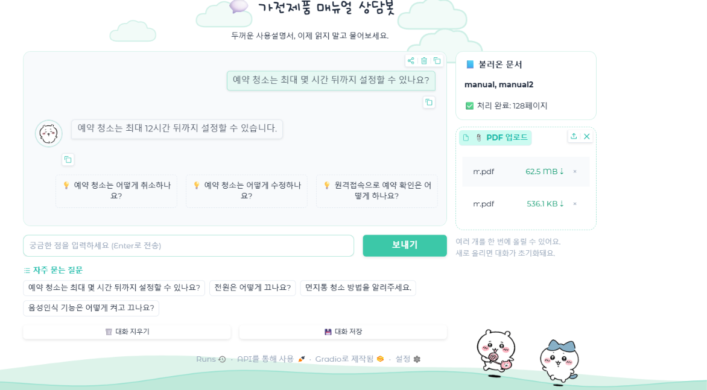

<div align="center">


<br />


### 작은 궁금증도, 함께 차근차근 🍀

가전제품 매뉴얼을 올리고 궁금한 내용을 질문해 보세요.  
필요한 사용 방법을 대화로 확인할 수 있습니다.


**[프로젝트 소개](#-프로젝트-소개) · [서비스 화면](#-서비스-화면) · [실행 방법](#-실행-방법) · [개선 결과](#-개선-내역과-성능-비교)**

</div>

## 🍀 프로젝트 소개

“예약 청소는 몇 시간 뒤까지 설정할 수 있지?”  
“먼지통은 어떻게 청소해야 하지?”

필요한 설명을 찾으려고 긴 매뉴얼을 넘겼던 경험에서 시작했습니다.
**먼작귀 가전제품 매뉴얼 상담봇**은 PDF 매뉴얼을 업로드하고 제품 사용 방법을 질문할 수 있는 서비스입니다.

흰색과 민트색, 둥근 화면 요소와 먼작귀 캐릭터를 활용해 사용설명서에 친근하게 접근할 수 있도록 구성했습니다.

### 해결하려는 문제와 대상 사용자

| 이런 불편함이 있다면 | 이렇게 사용해 보세요 |
| --- | --- |
| 설명서에서 필요한 항목을 찾기 어려워요 | 궁금한 내용을 문장으로 질문해요 |
| 여러 설명서를 번갈아 열어야 해요 | 여러 PDF를 함께 업로드해요 |
| 어떤 질문부터 해야 할지 모르겠어요 | 자주 묻는 질문과 후속 질문을 활용해요 |

가전제품 사용법을 빠르게 확인하고 싶은 분, 긴 문서보다 대화 방식이 편한 분을 위한 프로젝트입니다.

## 👥 함께 만든 사람들

| 팀원 | 역할 | 담당 내용 |
| :---: | :---: | --- |
| 입력 필요 | 입력 필요 | 입력 필요 |
| 입력 필요 | 입력 필요 | 입력 필요 |
| 입력 필요 | 입력 필요 | 입력 필요 |


## 🖥️ 서비스 화면

**배포 URL:** 입력 필요 — 실제 Hugging Face Spaces 주소로 변경해 주세요.



> PDF 업로드부터 질문과 답변, 후속 질문까지 한 화면에서 이용할 수 있습니다.

## 💬 이런 기능을 제공해요

| 기능 | 내용 |
| --- | --- |
| 📄 여러 PDF 업로드 | 가전제품 매뉴얼 파일을 함께 불러와요 |
| 📚 처리 상태 표시 | 불러온 문서와 처리된 페이지 수를 확인해요 |
| 💬 매뉴얼 질문 | 제품 기능과 사용 방법을 자연어로 질문해요 |
| 💡 후속 질문 | 답변과 함께 표시되는 질문으로 대화를 이어가요 |
| 🔎 자주 묻는 질문 | 예시 질문을 선택해 시작해요 |
| 💾 대화 관리 | 대화를 저장하거나 지울 수 있어요 |

### 사용 순서

1. 제품의 PDF 매뉴얼을 업로드합니다.
2. 문서 처리가 완료되면 궁금한 내용을 입력합니다.
3. 보내기 버튼을 누르거나 Enter로 질문을 전송합니다.
4. 답변을 확인하고 후속 질문을 이어갑니다.

새로운 PDF를 업로드하면 대화가 초기화됩니다.

## 🧰 사용 기술

| 구분 | 사용 기술 |
| --- | --- |
| 언어 | Python |
| 화면 | Gradio |
| 배포 | Hugging Face Spaces |
| LLM / 모델 | 입력 필요 |
| PDF 처리 | 입력 필요 |
| 검색 / 임베딩 | 입력 필요 |

## 🌱 실행 방법

저장소를 내려받고 프로젝트 폴더에서 아래 명령을 실행합니다.

```bash
python -m venv .venv
```

가상환경 활성화 — Windows PowerShell:

```powershell
.\.venv\Scripts\Activate.ps1
```

macOS / Linux:

```bash
source .venv/bin/activate
```

의존성을 설치합니다.

```bash
pip install -r requirements.txt
```

프로젝트에서 사용하는 API 키를 환경변수로 설정합니다. OpenAI API 사용 시 예시는 다음과 같습니다.

```powershell
# Windows PowerShell
$env:OPENAI_API_KEY="본인의_API_키"
```

```bash
# macOS / Linux
export OPENAI_API_KEY="본인의_API_키"
```

앱을 실행하고 터미널에 표시된 주소로 접속합니다.

```bash
python app.py
```

Spaces 배포 시에는 Settings의 Secrets에 코드가 사용하는 환경변수 이름으로 키를 등록합니다.


## 📚 사용 문서와 출처

| 문서 | 제조사 / 모델 | 공식 출처 |
| --- | --- | --- |
| 입력 필요 | 입력 필요 | 입력 필요 |
| 입력 필요 | 입력 필요 | 입력 필요 |

업로드 예시 파일명 대신 실제 문서명과 제조사의 매뉴얼 URL을 기재합니다.

## 🔧 개선 내역과 성능 비교

### 개선 내역

| 항목 | 개선 전 | 개선 후 |
| --- | --- | --- |
| 입력 필요 | 기존 문제 입력 | 실제 변경 내용 입력 |
| 입력 필요 | 기존 문제 입력 | 실제 변경 내용 입력 |

### 성능 비교 결과

동일한 매뉴얼과 질문으로 개선 전후를 비교합니다. 아래 항목은 아직 측정 결과가 등록되지 않았습니다.

| 평가 항목 | 개선 전 | 개선 후 |
| --- | :---: | :---: |
| 평가 질문 수 | 미측정 | 미측정 |
| 매뉴얼과 일치하는 답변 수 | 미측정 | 미측정 |
| 평균 응답 시간 | 미측정 | 미측정 |
| 매뉴얼에 없는 질문의 처리 결과 | 미측정 | 미측정 |

수치·조건·주의사항의 일치 여부와, 문서에 없는 내용을 임의로 답하지 않는지 확인합니다.

## 🔐 API 키 관리

API 키를 코드나 저장소에 올리지 않습니다. `.env`를 사용한다면 `.gitignore`에 추가합니다.
키가 커밋에 포함되었다면 파일 삭제만으로 해결되지 않으므로 해당 키를 폐기하고 재발급합니다.

## 🎨 이미지와 디자인 출처

- 캐릭터 이미지: [Chiikawa 공식 캐릭터 소개](https://www.chiikawaofficial.com/characters/)
- 작품 정보: [치이카와 애니메이션 공식 사이트](https://www.anime-chiikawa.jp/)
- 서비스 화면: 프로젝트 실행 화면
- 민트 배너와 물결: 이 README용으로 제작한 SVG
- 기술 배지: [Shields.io](https://shields.io/)

캐릭터와 원본 이미지의 권리는 각 권리자에게 있습니다. 출처 표기는 이용 허락을 대신하지 않습니다.
공식 캐릭터 이미지의 재사용 허락 범위는 확인이 필요하며, 이 프로젝트는 공식 서비스와 관련이 없습니다.

<div align="center">


**작은 궁금증을 하나씩, 더 편리한 일상으로 🍀**

</div>
